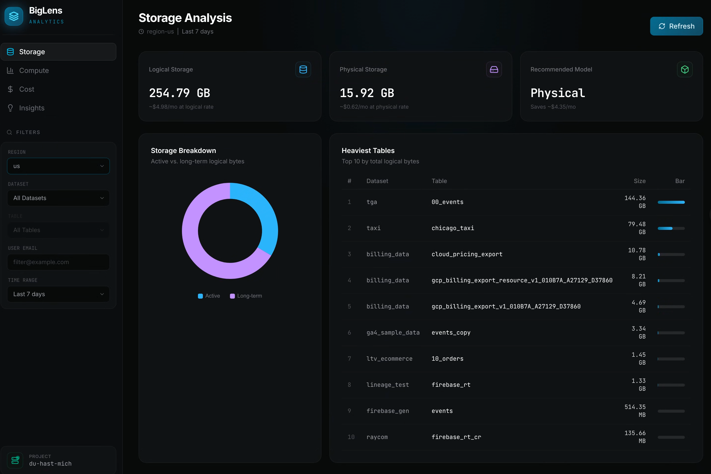
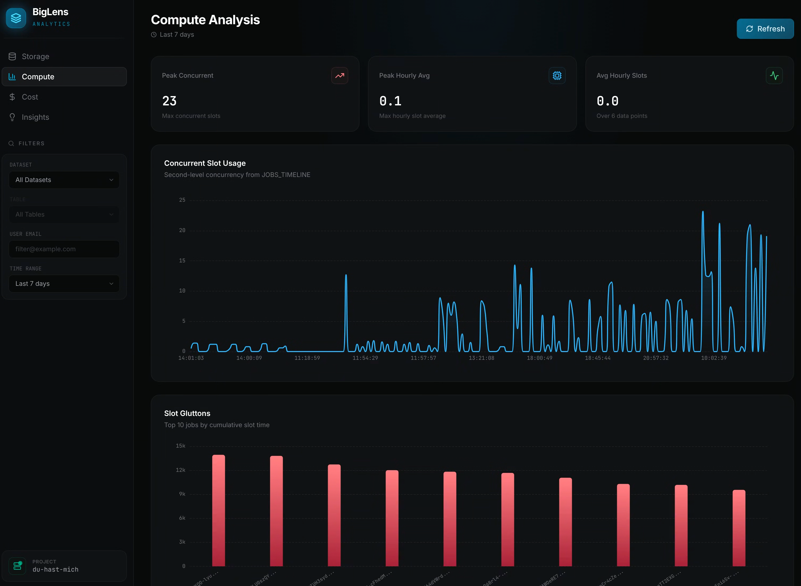
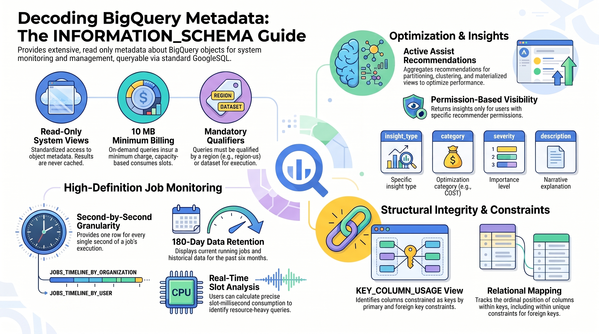

# BigLens

[](https://github.com/cloudymoma/biglens/actions/workflows/build.yml)

[English](README.md) | 简体中文

BigQuery 实时可观测性仪表盘。BigLens 通过查询 BigQuery 的 `INFORMATION_SCHEMA` 视图，将存储成本、计算槽位使用、用户级别开销和优化建议汇集在一个深色主题的 Web 界面中。





## 快速开始

### 前置条件

- **Go 1.22+**
- **Node.js 20+** 及 npm
- 具有 BigQuery 元数据访问权限的 **Google Cloud 凭证**（`roles/bigquery.resourceViewer`；安全态势中的行级访问策略检查还需 `bigquery.tables.list` 与 `bigquery.rowAccessPolicies.list`，例如 `roles/iam.securityReviewer`）

### 1. 配置

复制配置模板并填入你的 GCP 项目 ID：

```bash
cp conf.yaml.template conf.yaml
```

编辑 `conf.yaml`：

```yaml
server:
  port: 1983
  mode: "debug"        # "debug" 或 "release"

bigquery:
  project_id: "your-gcp-project-id"
  credentials_path: "" # 可选，留空则使用 GOOGLE_APPLICATION_CREDENTIALS
```

| 字段 | 说明 |
|---|---|
| `server.port` | 仪表盘 HTTP 端口（默认 `1983`） |
| `server.mode` | `debug` 详细日志，`release` 生产模式 |
| `bigquery.project_id` | 你的 GCP 项目 ID |
| `bigquery.credentials_path` | 服务账号 JSON 密钥路径。留空则使用应用默认凭证（`gcloud auth application-default login`） |

### 2. 构建并启动

```bash
make serve
```

该命令一键完成：
1. 安装前端依赖并构建 React 应用
2. 将前端静态文件复制到 Go 服务端
3. 编译 Go 二进制文件
4. 启动服务

在浏览器中打开 **http://localhost:1983** 即可使用。

### 其他 Make 命令

```bash
make build-frontend   # 仅构建 React 前端
make build-backend    # 仅编译 Go 后端
make build-all        # 构建前后端但不启动
make clean            # 清理构建产物
```

### 开发模式

前端热重载 + 后端 API 服务：

```bash
# 终端 1：启动 Go 后端
make build-backend && ./bin/biglens-server

# 终端 2：启动 Vite 开发服务器（自动代理 /api/* 到 1983 端口）
cd frontend && npm run dev
```

## 仪表盘

BigLens 提供五个仪表盘视图，均基于 `INFORMATION_SCHEMA` 查询驱动：

| 仪表盘 | 组件 |
|---|---|
| **存储** | 逻辑/物理计费模拟器、活跃/长期存储环形图、Top 10 最大表 |
| **计算** | 槽位使用时序图（JOBS_TIMELINE，按桶显示平均槽位——24 小时为 1 分钟、7 天为 10 分钟、30 天为 1 小时、90 天为 2 小时——并标出每个桶内最繁忙一秒的槽位）、槽位消耗 Top 10 作业 |
| **成本** | 按需成本估算（$6.25/TiB）、用户维度开销树状图 |
| **洞察** | BigQuery 活跃优化建议列表 |
| **IAM** | 按主体统计作业活跃度，检测不活跃账号（7/30/90 天窗口） |

### 全局筛选器

所有仪表盘共享侧边栏筛选面板：

- **区域** — 可搜索的 BQ 区域下拉框（默认 `us`）
- **数据集** / **表** — 将指标范围限定到特定数据集或表
- **用户邮箱** — 按用户或服务账号隔离指标
- **时间范围** — 24 小时、7 天、30 天或 90 天回溯

## Dataplex 知识目录

**Dataplex** 视图将数据目录呈现为可搜索、可浏览、可编辑的 2D/3D 交互式图谱。
它基于
[开放知识格式（OKF）](https://github.com/GoogleCloudPlatform/knowledge-catalog/blob/main/okf/SPEC.md)：
一个对 git 友好的 markdown 文件集合，每个文件是一个*概念*（节点），文件之间的
markdown 链接即为*边*。

- **图谱** — 力导向布局，可在 **2D** 与 **3D** 间切换。节点按 `type` 着色
  （BigQuery 表 / 视图 / 数据集、术语、指标等），边表示关系。
- **底部标签页** — **搜索**（按名称、类型或标签）、**详情**（所选节点的
  frontmatter、正文与关联）、**编辑**（创建、更新、删除概念，直接写入 markdown 包）。
- **从 Dataplex 导入** — 通过 Dataplex 通用目录的 `SearchEntries` 拉取实时条目
  写入 OKF 包，并生成两类边：
  - **包含关系** — `数据集 ⊃ 表`，由条目层级推导。
  - **血缘关系** — 源表 → 派生表的 ETL 数据流，来自
    [Data Lineage API](https://cloud.google.com/data-catalog/docs/concepts/about-data-lineage)
    （尽力而为；若该 API 未启用或无血缘记录，导入仍会成功并生成包含关系边，
    同时提示血缘已跳过）。
  编辑仅保存在本地包中（可通过 git 回滚），**不会**写回 Dataplex。

在 `conf.yaml` 中配置：

```yaml
catalog:
  bundle_path: "okf-bundle"   # OKF markdown 包所在目录
  dataplex:
    project_id: ""            # 为空时回退到 bigquery.project_id
    location: "global"        # Dataplex 搜索区域，如 "global" 或 "us"
  lineage_location: "us"      # Data Lineage API 区域（区域性，不可为 "global"）
```

运行时目录 `okf-bundle/` 已被 git 忽略（可能含导入的元数据）。仓库自带参考示例
`okf-bundle.sample/`，导入前可复制进来查看图谱：

```bash
cp -r okf-bundle.sample/. okf-bundle/
```

导入需要 `roles/dataplex.catalogViewer`；血缘边还需启用 Data Lineage API 并具备
`roles/datalineage.viewer` 权限。

## BigQuery 公共数据 (Open Data)

**BigQuery Open Data** 视图承载基于
[Google Cloud 公共数据集](https://cloud.google.com/bigquery/public-data)
的仪表盘。查询在你配置的项目中执行（计费在该项目），访问
`bigquery-public-data`；所有查询均带分区键过滤以控制扫描量，结果复用与其他
仪表盘相同的 10 分钟缓存。

### Google Trends

首个仪表盘，基于 `bigquery-public-data.google_trends`
（`international_top_terms` / `international_top_rising_terms`）：

| 组件 | 说明 |
|---|---|
| **热词榜单** | 各国家 Top 25 热词，行内分数进度条 |
| **词云** | 字号随 score 变化，Top 5 高亮 |
| **飙升热词** | 按 `percent_gain` 排序的 Top 10 飙升词及明细表 |
| **跨国热度对比** | 某个词在所有进入 Top 25 国家的最新分数 |
| **历史趋势** | 5 年周度历史，最多同时对比 5 个词，支持拖拽缩放 |

筛选器：国家、快照日期（`refresh_date` 分区）、当日榜单内的关键词搜索。
点击任意热词即可查看其跨国分布，并加入趋势对比图。

#### 指标说明

仪表盘展示的三个数字直接来自数据集，各自度量的维度不同，因此不会同步变化：

- **排名 Rank（1–25）** — 该词在所在国家当日热榜中的位置，按当天的
  *绝对搜索量*排序。热词榜单即按此排序。
- **分数 Score（0–100）** — Google 的*相对*搜索热度指数，基于最新一周数据：
  每个词以自身历史峰值做归一化，100 表示"本周正处于（或追平）该词的
  热度巅峰"。数据集按地区（region）粒度提供该值，BigLens 会对国家内
  所有地区取平均并取整（`CAST(COALESCE(AVG(score), 0) AS INT64)`，
  score 为 NULL 时按 0 计）。榜单每行的内嵌进度条可视化的就是这个值。
- **涨幅 Gain（%）** — 仅飙升热词有此指标：相对于基期的搜索量增长百分比
  （`percent_gain`）。全新爆发的查询词涨幅可达数千个百分点。

由于排名反映的是*当日绝对搜索量*，而分数反映的是*相对该词自身历史的
热度*，一个排在第 14 位的词可能分数为 100（刚创下历史新高），而第 1 名
的词分数反而更低（搜索量巨大，但已过热度峰值周）。因此榜单刻意按排名
而非分数排序。

### GDELT 实时舆情（News Pulse）

实时全球新闻情绪与地缘态势监控仪表盘，基于
[GDELT 项目](https://www.gdeltproject.org/) 2.0 数据表
`gdelt-bq.gdeltv2.events_partitioned` 与 `gdelt-bq.gdeltv2.gkg_partitioned`。
GDELT 以机器方式阅读全球 100 多种语言的新闻媒体，每 15 分钟更新一次；
BigLens 直接查询官方分区底表（不创建任何中间表或视图）。

| 组件 | 说明 |
|---|---|
| **全球事件热点图** | 世界地图 Top 500 地点 —— 气泡大小 = 事件数，颜色 = 平均情绪 |
| **情绪仪表盘** | 所选区间的加权全球平均情绪 |
| **热度与情绪走向** | 每日事件数（柱）与每日平均情绪（线）双轴图 |
| **合作与冲突态势** | 四类 QuadClass 事件占比环形图 |
| **风险矩阵** | 事件类型按 Goldstein 分（x）× 活跃度（y，对数轴）分布 —— 右下象限为高活跃 × 高破坏性 |
| **冲突类别排行** | 各 CAMEO 冲突根编码的事件数（抗议、胁迫、袭击、战斗……） |
| **突发冲突新闻** | 提及数最高的 Top 50 冲突报道，每个源 URL 仅一行 |
| **热点主题 Treemap** | Top 50 GKG 主题，按文章数计权 |
| **核心人物 / 媒体阵营** | Top 20 报道人物与 Top 10 媒体（按平均情绪着色） |

筛选器：快捷区间（3 / 7 / 30 天）+ 自定义 UTC 日期区间。事件面板最长支持
90 天；主题/实体（GKG）面板最长 30 天且独立加载，不会拖慢事件图表。

#### 数据含义

GDELT 是*新闻报道*的索引，而非经核实事件的登记册。每行是从一篇新闻报道中
机器编码出的一条"谁对谁做了什么"，因此同一现实事件被多家媒体报道会产生
多行 —— 计数度量的是**媒体关注度**，这正是舆情看板应呈现的语义。

- **报道日期（Date reported）** — GDELT 抓取该报道的 UTC 日期
  （`_PARTITIONDATE`），并非事件实际发生日期。对"当下新闻在报道什么"
  这正是所需的时间轴；它同时也是分区键，所有查询只扫描所选天数的分区。
- **情绪 Tone** — 描述该事件的报道文本的平均情绪值，来自 GDELT 情感
  引擎。理论区间 −100…+100，实际几乎都落在 −10…+10：低于 −2 为明显
  负面报道，高于 +2 为正面。
- **Goldstein 分（−10…+10）** — 政治学标准量表，衡量某*事件类型*对国家
  稳定性的理论影响（如"提供援助"强正面、"战斗"强负面）。该分值按
  CAMEO 事件类型固定 —— 评价的是行为种类，而非单篇报道。
- **QuadClass（1–4）** — GDELT 最粗粒度的事件分类：言语合作、实质合作、
  言语冲突、实质冲突。第 3–4 类构成"冲突占比"指标与突发新闻列表。
- **CAMEO 根编码（'01'–'20'）** —
  [CAMEO 分类体系](http://data.gdeltproject.org/documentation/CAMEO.Manual.1.1b3.pdf)
  的 20 个顶层事件类别（呼吁、磋商、威胁、抗议、战斗……），'10' 及以上
  为冲突侧。API 返回原始编码，标签映射在前端完成。
- **提及数 Mentions** — 事件在全部被监测文档中被提及的次数
  （`NumMentions`），是突发新闻表的排序信号。
- **主题 / 人物（GKG）** — 来自全球知识图谱（Global Knowledge Graph），
  它为每篇*文章*标注主题（如 `PROTEST`、`WB_2670_JOBS`）与人物。权重为
  **文章数**：一篇文章提及某主题十次也只计一次，避免长文偏置 Treemap。
- **媒体情绪** — 该媒体在区间内所有文章的文档情绪（GKG `V2Tone` 复合串
  第 0 段）的平均值。

#### 指标如何计算

- **加权平均，绝不做"均值的均值"。** BigQuery 按（日期 × QuadClass ×
  事件类型）分组返回每组的 `AVG` 与 `COUNT`，Go 后端按
  `Σ(avg×n)/Σ(n)` 上卷 —— 与直接对明细求平均在数学上完全等价。若对
  分组均值做简单平均，一个 10 条事件的小组会与 10 万条事件的大组拥有
  同等权重，扭曲全局情绪。
- **地理热点**：事件坐标取整到 0.1°（约 11 km）网格后按格聚合，地图
  展示最繁忙的 500 个网格。
- **突发新闻**按 `SOURCEURL` 去重（每篇文章仅保留提及数最高的事件行）——
  GDELT 会为同一篇报道生成多条事件行，否则单一大新闻会刷屏 Top 50。
- **成本防护**：原生 `DATE` 参数直连分区键、硬性跨度上限（90 / 30 天）、
  服务端 `GROUP BY + LIMIT`、共享 10 分钟缓存，以及 `singleflight` 请求
  合并（并发相同请求只触发一次 BigQuery 作业）。默认 3 天窗口的一次
  全量缓存未命中扫描量远低于 1 GB —— 按需计费下不足一美分。

### 全球天气（Global Weather）

基于 NOAA GHCN-Daily（`bigquery-public-data.ghcn_d`）的全球陆地气象站逐日
观测：约 2 万个站点，数据约滞后一天。

| 组件 | 说明 |
|---|---|
| **KPI 栏** | 报告站点数、最热 / 最冷 / 降水最多站点、有积雪的站点数 |
| **站点地图** | 快照日全球站点观测（最高/最低气温、降水、降雪） |
| **每日趋势** | 全网平均气温/降水与报告站点数走势 |

筛选器：快照日期（可回溯至 1900 年）与 7–31 天回溯窗口。趋势均值为报告
站点的网络均值，并非物理意义上的全球平均；默认日期会跳过尚在回填中的最新
1–2 天。

### Crypto Pulse（链上加密数据）

涵盖比特币、以太坊、Arbitrum、Optimism、Base、Polygon、TRON 与 Solana 的链上
基本面与实时收款/风控信号，基于 `bigquery-public-data.crypto_bitcoin`、`crypto_ethereum`
与 `goog_blockchain_*`（2026 年 8–9 月起由 SQD 数据管线生产，并以 Analytics Hub 关联视图对外提供，
通常仅比链头滞后数秒，比特币约滞后 1 个区块，详见[数据源说明](#数据源说明2026-sqd-迁移)；日级分析接口对齐至已结算的
完整 UTC 日）以及实时公共 RPC 与区块浏览器索引。七个懒加载标签页：

| 标签页 | 组件 |
|---|---|
| **网络脉搏** | 双链 KPI（最新完整 UTC 日）、每日交易数、结算金额、活跃地址（近似去重发送方，≤90 天）、区块拥挤度、出块量、链上 ETH/BTC 日价格（Uniswap v3），并在结算金额与手续费旁给出 `≈ $` 折算 |
| **手续费市场** | **72h Gas Pulse**（默认）：BTC、ETH、Arbitrum、Optimism、Polygon、TRON 与 Solana 最近 72 个完整 UTC 小时的费率区间与负载趋势、72h 分位数/中位数、全时 Base Fee 极值（从预置基线增量扫描 BigQuery，每日后台刷新；纪录过期或刷新失败时，卡片会提示并标明已核验到哪一天）及 TRON 能量价格历史；以及 **Daily Economics**：BTC 中位数 sat/vB 与 ETH 平均 gwei 趋势、BTC 矿工收入（补贴 vs 手续费）、ETH EIP-1559 销毁 vs 小费、拥挤度-费率散点图，并按当日链上价格给出 `≈ $` 折算 |
| **巨鲸与资金流** | Top 50 大额转账（区块浏览器链接）、巨鲸交易趋势（≥100 BTC / ≥1,000 ETH）、Top 收款地址、Top 1% 金额集中度（仅统计有转账金额的交易） |
| **代币经济** | Top 25 代币合约（按 Transfer 事件数，含 ERC-20 与 ERC-721）、代币 vs 原生交易活跃度、新合约部署、代币流动 Treemap |
| **挖矿经济** | 全网算力（7 日均值 + 单日隐含值）、矿工收入、每 TH/s 收益、最新一日矿机经济性、各矿机关机币价（可调电价、PUE、矿池费率、BTC 价格、自定义矿机） |
| **收款核验（Payment Check）** | 面向收款地址的实时入账核验，支持 USDT、USDC、ETH、TRX、BTC、SOL 在 Ethereum、Arbitrum、Optimism、Base、TRON、Bitcoin 与 Solana 上的三档终局余额、最新入账结算进度（`DANGER` / `SOFT` / `SAFE` → `FINALIZED`）、官方/桥接/仿冒代币识别、7 天转账历史（防地址投毒与 BIP-125 RBF 检测）、付款方独立风险筛查，以及自有 EVM 收款地址的 EIP-7702 委托告警，详见下文 [Payment Check](#payment-check收款地址入账核验) |
| **地址风险（Address Risk）** | 多链地址风险线索查询（Ethereum、Arbitrum、Optimism、Base、TRON、Bitcoin、Solana）、发行方与 SPL 实时冻结检查、EIP-7702 委托检测、批量假币部署者情报、可选开启的 BigQuery 地址画像（以太坊）、冻结历史概览、**Scam Radar（诈骗雷达）**（30 天 ETH/TRON 地址投毒与假币趋势、Top 10 活跃假币合约与部署者、BTC 显式 RBF 占比）与数据源表，详见下文 [Address Risk](#address-risk多链地址风险线索) |

区间：各页支持 7/30/90 天，轻量聚合趋势（网络脉搏、手续费、挖矿）另支持 1 年；
代币查询上限 30 天。日级接口对齐至已结算的完整 UTC 日（带午夜后 20 分钟入库缓冲），
并缓存至下一个 UTC 日切换。缓存前会先用一次很便宜的分链就绪探针（约 2–8 MB，结果缓存 5 分钟）
确认数据源已入库到午夜之后；若尚未就绪，响应只缓存 5 分钟并带上 `last_day_complete: false`
（若探针查询本身报错，还会带上 `last_day_probe_failed: true`），页面分别提示最新一日仍在入库或就绪探针失败。所有查询均限制时间窗口并设置 `MaxBytesBilled`。
公共视图依靠 `block_timestamp` 聚簇完成裁剪（细到小时级同样有效），因此不再使用
`block_timestamp_month` / `timestamp_month`：它们已不是分区键，加上只会多扫字节。
`crypto_ethereum.blocks` 与 `contracts` 另外携带 Merge 后区块号下界（`number >= @start_block`
/ `block_number >= @start_block`），用于裁剪按区块号划分的范围分区。

#### 数据源说明（2026 SQD 迁移）

2026 年 8–9 月，Google 把这批区块链公共数据集迁到了 SQD（原 Subsquid）的数据管线上（双方已于 2026 年 8 月公开宣布合作）。
客户查询路径没有变，BigLens 的查询无需修改。从 BigQuery 侧可以观察到的变化如下：

- **关联视图**：`crypto_bitcoin`、`crypto_ethereum` 与全部 `goog_blockchain_*_us` 都变成了 Analytics Hub
  关联数据集，表全部是 VIEW。按数据集元数据中的创建时间：Avalanche 08-07、Polygon 08-21、Arbitrum 08-24、
  Ethereum（`goog_blockchain_ethereum_mainnet_us`）与 Cronos 08-31、TRON 与 Optimism 09-14、
  `crypto_bitcoin` 09-16、`crypto_ethereum` 09-22。
- **裁剪行为**：时间谓词可以裁剪到小时级；`block_timestamp_month` / `timestamp_month` 已不再起分区过滤作用，
  加上只会多扫字节；字面量的区块号下界可以裁剪 `blocks` / `contracts` 视图。
  这些视图的 dry-run 字节数只是上限，`maximum_bytes_billed` 也是在作业开始前按这个上限检查的。
- **新鲜度**：落后链头数秒，比特币约 1 个区块。链头附近的数据可能因重组被回滚，所以 BigLens
  仍只读取已结算的 UTC 日或完整小时，`goog_blockchain_*` 的事件表也继续带 `NOT removed` 过滤。
- **语义变化**：`crypto_bitcoin.inputs` 现在每个区块多一行 coinbase 输入（Scam Radar R5 已排除），
  没有地址的输入其 `inputs.addresses` 由 `NULL` 变为 `[]`。`crypto_ethereum` 新增 `tokens_latest`
  （每个合约一行，含部署者与代理信息）和 `token_supply_latest`。`decoded_events` 只能解码有已知 ABI
  的事件：2026-10-11 以太坊上约 73% 的事件被解码，USDT 黑名单事件不在其中，所以冻结同步仍读取原始 `logs`。
- **覆盖范围**：Arbitrum、Optimism、Polygon 没有 `token_transfers` 与 `traces`，Optimism 的 receipts
  也没有 L1 费用列（因此 72h OP 序列只含 L2 执行费；实时阶梯图通过 RPC 补上 L1 数据费）。
  `bigquery-public-data` 中没有 Base 链数据集，也没有 EU 副本。Flashbots mempool 与 Tektonic x402
  是另外的 Analytics Hub listing，BigLens 没有使用。

#### 数据含义

数据集本身**没有法币价格**，所有指标都是原生单位（BTC、ETH、gwei）或计数。BigLens 在链上自行推算
ETH/USD 与 BTC/USD 日价格（见[链上价格](#链上价格uniswap-v3)），只作为原生单位旁的 `≈ $` 提示：

- **结算金额（BTC）** 为交易输出之和，包含返回发送方的找零 —— 是经济转移
  量的上界，图表提示中亦有注明。以太坊结算金额统计成功顶层交易（`receipt_status = 1`）的 `value`，不含合约内部转账。
- **活跃地址** 为每日近似去重发送方（`APPROX_COUNT_DISTINCT`，约 1% 误差），
  衡量网络活跃度而非用户数（一人可持有多个地址）。
- **代币活跃度只统计转账次数，绝不求和金额**：跨代币金额相加没有意义，且
  长尾代币的 `decimals` 元数据不可靠。
- **巨鲸阈值**（≥100 BTC、≥1,000 ETH）为原生单位常量，与价格无关。

#### 链上价格（Uniswap v3）

ETH/USD 与 BTC/USD 日价格直接在 BigQuery 中由 `goog_blockchain_ethereum_mainnet_us.decoded_events`
里的 Uniswap v3 兑换事件算出，不调用任何价格 API。ETH/USD 取自 USDC/WETH 0.01% 与 0.05% 两个池子
（`1e12 / 1.0001^tick`）。BTC/USD 由 WBTC 推导：先用 WBTC/WETH 0.05% 与 0.3% 池子算出每个 WBTC 值多少
WETH（`1.0001^tick · 1e-10`），再乘以同一小时的 ETH/USD。为控制扫描量，每个 UTC 日只读取 4 个 1 小时窗口
（00、06、12、18 UTC），以字面量时间区间写入查询，靠聚簇完成裁剪。某小时 ETH 至少有 5 笔兑换、或 WBTC 至少有
2 笔兑换才计入，日价格取当天合格小时中位数的中位数。

后台同步把每日价格写入 `data/security.db` 中的 `onchain_prices_daily` 表：

- **首次启动**回填 `crypto_prices.initial_days` 天（默认 365，最大 730，设为 `0` 关闭），约 125 GiB，一次性约 $0.8。
- **之后每天增量**一天（约 360 MiB，约 $0.002/天），条件是当天 18:00 窗口已经入库（19:30 UTC 之后）。
- **出错处理**：产生计费的失败会退避 6 小时。SQLite 打不开时价格只保存在内存中，冷启动最多回填 31 天。
- **读取接口**：`GET /api/opendata/crypto/prices?days=7|30|90|365` 只读已存数据，不会查询 BigQuery。

这是 DEX 推算价格而非交易所指数，界面上也有注明。

#### Payment Check（收款地址入账核验）

粘贴你自己的收款地址，实时核验 **USDT**（`tron`、`eth`、`arb`、`op`、`base`、`sol`）、**USDC**（`eth`、`arb`、`op`、`base`、`sol`）、**ETH**（`eth`、`arb`、`op`、`base`）、**TRX**（`tron`）、**BTC**（`btc`）与 **SOL**（`sol`）的入账状态：

- **三档终局水位与余额拆分** —— EVM 链并发读取 `finalized`、`safe` 与 `latest` 块高（做单调钳制，防止不同节点高度差导致顺序倒置），将余额拆分为 **Finalized**、**Safe, not final**（`safe − finalized`）与 **Latest only**（`latest − safe`）三列；Bitcoin 读取 Esplora 最新高度（`mempool.space` 主源 + `blockstream.info` 回退），将内存池 0 确认交易判为 `DANGER`（提示 full-RBF 替换双花风险与显式 BIP-125 `rbf_signaled`）、`1–2 确认` 判为 `SOFT`、`3–5 确认` 判为 `SAFE`、`≥6 确认` 判为 `FINALIZED`；Solana 按 `finalized`、`confirmed` 与 `processed` 三档 commitment 读取 slot 水位与原生/SPL 余额（单请求并发，不发 JSON-RPC batch）；TRON 读取 `/walletsolidity` 与 `/wallet`，展示 **Solidified** 与 **Unconfirmed**（`latest − solidified`）。稳定币达到 `FINALIZED` 时始终提示发行方（Tether / Circle）仍可在合约或 SPL Token 账户层冻结资产。
- **代币合约与 Mint 注册表（`native` / `bridged` / `counterfeit` / `other`）** —— `backend/chain_registry.go` 涵盖 EVM、TRON 与 Solana 官方铸币地址（USDT `Es9vMFrzaCERmJfrF4H2FYD4KCoNkY11McCe8BenwNYB`、USDC `EPjFWdd5AufqSSqeM2qN1xzybapC8G4wEGGkZwyTDt1v`）。桥接版本（Arbitrum / Optimism 上的 `USDC.e`、Optimism 与 Base 上的旧桥接 `USDT`）显式标注警告；未在注册表中但 EVM/TRON 合约符号或 Solana Metaplex 元数据符号归一化后酷似 `USDT`/`USDC`/`USD₮`（或在以太坊本地 `scam_fake_tokens` 假币库中命中）的代币会被标记为 `counterfeit_token`（假币）。
- **7 天转账历史、UTXO/ATA 归属还原与地址投毒检测** —— 合并近期 RPC 日志、Esplora UTXO 分页（`mempool.space`）或 Solana `getSignaturesForAddress` + `maxSupportedTransactionVersion: 1` 交易解析（将 SPL 关联代币账户 ATA 还原为 owner 钱包地址，确保 0 元投毒识别攻击者钱包而非代币子账户）。按时间从旧到新扫描（0 确认内存池交易排在最后扫描，绝不进入历史可信对手方集合），标记 `zero_value`、`dust`、`rbf_signaled`、`lookalike`（剥离 EVM `0x` 与 SegWit/Taproot `bc1q`/`bc1p` 固定前缀后比对前 4 位 + 后 4 位）、`lookalike_known`、`sent_to_lookalike`、`counterfeit_token`、`counterfeit_deployer`（该代币的部署者或交易对手是 Scam Radar 识别出的批量假 USDT/USDC 部署者）、`failed` 与 `counterparty_listed`。默认开启的「隐藏 0 元与无关代币」筛选只隐藏噪音，绝不隐藏 `DANGER`、`rbf_signaled` 或任何带风险标记的行。
- **独立的付款方风险筛查** —— 当最新入账的 `tx_hash` 发生变化时，对付款方地址执行一次 Address Risk 查询，不会随 5 秒结算轮询重复请求。查询过的收款地址仅保存在 URL hash（`#pay?asset=…&network=…&address=…`）与短时内存缓存中。付款方筛查不会触发可选的 BigQuery 地址画像。
- **EIP-7702 委托告警** —— 在 Ethereum、Arbitrum、Optimism 与 Base 上，实时核验还会读取你的收款地址代码（`eth_getCode`）。若该地址带有生效中的 EIP-7702 委托（`0xef0100…`），页面会给出警告并标明被委托的合约，因为该合约中的代码可以转走转入的资金。页面底部的数据源列表会显示这项检查（"EIP-7702 delegation (live)"），检查失败时附带 RPC 错误。

#### Address Risk（多链地址风险线索）

选择链（**Ethereum**、**Arbitrum**、**Optimism**、**Base**、**TRON**、**Bitcoin** 或 **Solana**）并输入地址，查看按 Critical / Warning / Association / Info 分级的**风险线索**。BigLens 从不把地址标为"安全"：没有发现记录时，会说明查询了几个来源、哪些来源没能完成查询。

| 来源 | 覆盖的链 | 方式 | 会把地址发给第三方？ |
|---|---|---|---|
| OFAC SDN（经 [0xB10C](https://github.com/0xB10C/ofac-sanctioned-digital-currency-addresses) 提取，MIT） | ETH、Arb、OP、Base、TRON、BTC、SOL | 每 6 小时同步到本地 SQLite（含 `ETH`、`TRX`、`XBT`、`SOL` 以及 `USDT`/`USDC` 文件中的 TRON 与 Solana 地址） | 否 |
| [MEW darklist](https://github.com/MyEtherWallet/ethereum-lists)（MIT；历史名单，2020-11 起未更新） | ETH、Arb、OP、Base | 每 6 小时同步到本地 SQLite | 否 |
| USDT / USDC 冻结、解冻、销毁事件（`crypto_ethereum.logs`） | ETH | 按完整 UTC 日从 BigQuery 同步 | 否 |
| TRON USDT 冻结、解冻、销毁事件（`goog_blockchain_tron_mainnet_us.logs`） | TRON | 按完整 UTC 日从 BigQuery 同步（`tron_stablecoin`） | 否 |
| 已知尾号投毒仿冒地址库（`scam_lookalikes`） | ETH、Arb、OP、Base、TRON | 按完整 UTC 日从 BigQuery 同步（ETH 0 元投毒 + TRON 灰尘投毒；EVM 外部账户跨 L1/L2 共享） | 否 |
| 批量假稳定币部署者（`fake_token_deployers`） | ETH、Arb、OP、Base（以以太坊为准） | 由 Scam Radar 每日基于 `crypto_ethereum.tokens_latest` 刷新：部署了 ≥3 个符号仿冒 USDT/USDC/USD₮ 的非官方合约、且假币占其所部署全部合约 ≥20% 的地址（排除通用发币工厂、CREATE2 与跨链桥工厂合约） | 否 |
| **发行方冻结实时检查（`issuer_freeze`）**（`isBlackListed` / `isBlacklisted` / `isBlocked` / SPL 账户冻结状态） | ETH、Arb、OP、Base、TRON、SOL | 对注册表中的 USDT / USDC 合约或 Solana ATA 发起实时 `eth_call`、TronGrid `triggerconstantcontract` 或 Solana `getMultipleAccounts` | 是，发给 RPC / TronGrid / Solana RPC 服务商 |
| **EIP-7702 委托实时检查（`eip7702`）** | ETH、Arb、OP、Base | 实时 `eth_getCode`：带有生效中的委托（`0xef0100…`）时给出警告并标明被委托合约，并通过 Blockscout 补充该合约的验证名称或诈骗标记 | 是，发给 RPC 服务商（被委托合约地址会发给 Blockscout） |
| Chainalysis 链上制裁预言机（`isSanctioned`） | ETH、Arb、OP | 通过公共 RPC 实时 `eth_call`（Base 未部署） | 是，发给 RPC 服务商 |
| [GoPlus](https://gopluslabs.io) 地址安全接口 | ETH、Arb、OP、Base、TRON | 实时，免 key（`chain_id` `1` / `42161` / `10` / `8453` / `tron`） | 是，发给 GoPlus |
| Blockscout 公开标签与诈骗标记 | ETH、Arb、OP、Base | 实时，免 key（对应各链 Blockscout 实例） | 是，发给 Blockscout |
| Etherscan / Blockscout 关联分析（ETH 可选免费 key） | ETH | 实时查询 `txlist` / `tokentx` / `txlistinternal`，一跳，带防投毒过滤 | 是，发给 Etherscan（带你的 key）或 Blockscout |
| **BigQuery 地址画像（可选开启）**（`bigquery_profile`） | ETH | 仅在打开 **BigQuery profile** 开关时：对按地址聚簇的 `transactions_by_from_address` / `transactions_by_to_address` 视图执行一次带扣费上限的查询（见下文） | 不发给第三方 —— 在你自己的 GCP 项目中执行，但地址会出现在该项目的 BigQuery 作业历史中 |

本地数据存放在 `data/security.db`（相对于工作目录，可用 `address_risk.db_path` 修改）。文件打不开时服务照常启动，查询结果会标明本地名单不可用。查询过的地址只保存在 10 分钟的内存缓存里，不写磁盘，也不写日志。唯一的例外是可选的 BigQuery 地址画像：开启后，地址会作为查询参数发送到你自己项目中的 BigQuery，因此会出现在该项目的作业历史里。

**BigQuery 地址画像（可选开启，仅以太坊）**。查询框旁边有一个默认关闭的 **BigQuery profile** 开关，旁边的 **?** 图标在鼠标悬停时会说明开启后能得到什么。打开后（选择会记在当前浏览器里），以太坊查询会额外对 `goog_blockchain_ethereum_mainnet_us.transactions_by_from_address` 与 `transactions_by_to_address` 执行一次参数化查询。这两个视图按地址聚簇，查询只读取可能包含该地址的存储块，不扫全链。不论地址活跃度高低，一次完整画像计费约 0.9 GiB（约 $0.006）：vitalik.eth 与一个从未使用过的地址都约为 0.97 GB，而不聚簇时扫描同样的列需要 180 GiB 以上。画像包括：

- 全历史中的首笔资金来源（first funder，即最早一笔有金额的转入，附区块号）与账户年龄；
- 终身转入/转出笔数、去重对手方数量、ETH 转移量与最近活跃时间。这些数字只统计顶层交易，包含失败交易，不含内部转账与代币转账；
- Top 对手方，以及它们与本地 OFAC / MEW / 冻结 / 仿冒地址 / 批量假币部署者名单的一跳交集，以关联线索形式给出（其中假币部署者仅对首笔资金来源及向目标地址发起过顶层交易的对手方生效，避免公共发币工厂合约误伤普通调用者）。

整个过程不需要 Etherscan key，也不调用第三方 API。防护配置都在 `address_risk.bigquery_profile` 下：

- `enabled`（默认 `true`）：允许用户开启；设为 `false` 则不提供此功能。
- `max_bytes_billed`（默认 2 GiB，上限 10 GiB）：单次扣费上限。像 DEX 路由合约这样极活跃的地址会在执行前被拒绝，提示"too active for the configured BigQuery budget"，且不产生费用。
- `max_per_hour`（默认 60，上限 600）：全局限流。
- `timeout_seconds`（默认 20，最大 45）：最长等待时间。画像慢时，查询响应最多因此延迟这么久；超时后才完成的作业仍会写入缓存。

按默认配置，每小时 60 次常规画像约计费 60 × 0.9 GiB ≈ $0.33/小时，硬上限封顶为 `max_per_hour × max_bytes_billed` = 60 × 2 GiB = 120 GiB/小时（约 $0.73/小时）。结果（包括超出预算的判定）会缓存 10 分钟，重复查询不再计费。

**冻结历史（BigQuery）**。服务首次启动时同步最近 30 天的以太坊 USDT/USDC 冻结事件（实际计费约 92 GB / 86 GiB，一次性约 $0.54），之后每天增量同步一天（`logs` 表实际计费约 3.4–3.6 GB/天，dry-run 上限约 4.4 GB + 分区完整性检查约 25 MB，每天约 $0.02）。`address_risk.initial_sync_days` 可修改首次同步天数（最大 31；设为 0 则跳过首次同步，已有游标仍会每日增量）。全量回填之前，查询结果会注明 "Freeze history covers … only"。除本地以太坊与 TRON 历史事件外，ETH、Arbitrum、Optimism、Base 与 TRON 的每次查询都会执行实时 `issuer_freeze` 合约调用，因此在回填完成前也能查出当前冻结状态。以太坊全量回填时服务可以继续运行：

```bash
cd /opt/biglens/backend && sudo -u biglens ./biglens-server --address-risk-backfill        # 只做 dry-run：打印每年的预估费用（仅运行约 25 MB 的区块水位检查，不跑回填批次）
cd /opt/biglens/backend && sudo -u biglens ./biglens-server --address-risk-backfill --yes  # 全量（2017-11-28 至今）：约 3.4 TB，约 $20
```

必须先 `cd`（conf.yaml、`logs/`、`data/` 都按工作目录解析），也必须用 `sudo -u biglens`（否则数据库文件归 root 所有，服务写不进去）。`--since YYYY-MM-DD` 限定起始日期；`--since-days N` 只供开发环境使用。中途失败可以直接重跑，从断点继续。

**Scam Radar（BigQuery 每日链上反诈情报）**。在 Address Risk 概览页的冻结 KPI 下方，**Scam Radar** 每日从 BigQuery 同步四路反诈情报，并将结果同时用于概览看板、Address Risk 单地址查询、Payment Check 与 Whales & Flow：

- **ETH 0 元尾号投毒（`scam_eth` / R1）** —— 扫描 `goog_blockchain_ethereum_mainnet_us.token_transfers` 中官方 USDT 与 USDC 的 0 元转账，将其与同一受害者在**同一 UTC 日**内的真实收款方比对（前 4 位与后 4 位十六进制字符同时相同）。
- **ETH 假冒 USDT/USDC 合约（`scam_eth` / R2）** —— 将 `token_transfers` 与 `crypto_ethereum.tokens_latest`（每个合约一行）关联，找出符号匹配 `^(USDT|USDC|USD₮)[^A-Z0-9]?$` 的非官方合约，展示近 7 天最活跃的 Top 10 假币合约，并写入 `scam_fake_tokens`（现在包含每个合约的部署者）供 Payment Check 识别假币。
- **批量假币部署者（`scam_eth`）** —— 每天把 `tokens_latest` 中部署了至少 3 个上述假币合约、且假币合约占该地址所部署全部去重合约至少 20%（`contracts * 5 >= COUNT(DISTINCT address)`）的部署者存入 `scam_fake_token_deployers`（在不增加任何 BigQuery 扫描字节的前提下过滤掉通用发币平台、CREATE2 与跨链桥工厂合约）。2026-10-13 共有 1,070 个这样的部署者、对应 20,337 个假币合约，单个地址最多部署了 4,394 个。该名单用于 `fake_token_deployers` 查询来源、Payment Check 的 `counterfeit_deployer` 标记、巨鲸页顶层发送方标记，以及概览页的 KPI 与 Top 5 列表。
- **TRON USDT 灰尘投毒（`scam_tron` / R3）** —— 扫描 `goog_blockchain_tron_mainnet_us.logs` 中官方 TRON USDT（`TR7NHqjeKQxGTCi8q8ZY4pL8otSzgjLj6t`）的小额转账（`< 0x100000` 最小单位，约 1.05 USDT，含仿冒地址转入与伪造的转出两个分支），与同一受害者**同一 UTC 日**的真实转账配对，并在 BigQuery 内直接完成 Base58Check 前 4 位 + 后 4 位比对。
- **TRON USDT 冻结事件（`tron_stablecoin_logs` / R4）** —— 同步 TRON USDT 的 `AddedBlackList`、`RemovedBlackList` 与 `DestroyedBlackFunds` 日志至 `tron_stablecoin_events`，驱动概览页的 **USDT frozen now (TRON)** KPI 卡片与 `tron_stablecoin` 查询来源。
- **BTC 显式 RBF 占比（`scam_btc` / R5）** —— 从 `crypto_bitcoin.inputs` 统计每日至少有一个输入开启 BIP-125 显式费用替换（`sequence < 0xfffffffe`）的比特币交易占比，直观说明为何 0 确认 BTC 交易绝不能视为已到账。coinbase 输入（`spent_output_index IS NULL`）不计入：SQD 数据集每个区块都有一行，其中不少 `sequence` 偏低。
- **防"静默 0"保护** —— 上游 schema 或格式变化可能让某条过滤条件突然什么都匹配不到，查询却照样"成功"返回 0。因此每次运行都会核对数据源及匹配谓词确实返回了数据：R1 统计每天扫描到的官方 USDT/USDC 转账数与 0 元转账数，R3 统计每天的官方 TRON USDT 转账数与灰尘投毒候选数，R4 统计每天扫描到的官方 TRON USDT 日志数，R5 统计每天的 BTC 交易数，假币部署者至少有 1 个。被判定可疑的运行不写入任何数据、不推进游标，并退避 6 小时；`last_error` 形如 `suspicious empty result for 2026-10-12: 0 official USDT/USDC transfers scanned — upstream schema or format change?`。若上游确实出现 0 候选的合法日期，可在配置中设 `address_risk.scam_radar.allow_zero_candidates: true` 跳过每日 0 元/灰尘候选数下限（改为打印告警），但仍保留每日总转账数 `>= 1` 的表健康底线。
- **下限口径与成本** —— 由于 R1 与 R3 只和**同一 UTC 日**内的真实转账配对，跨天投毒（先正常转账、数日后再投毒）不会被计入，因此看板与线索中的投毒命中数均为**下限（lower bound）**。Scam Radar 默认开启（`address_risk.scam_radar.initial_days: 30`、`retention_days: 90`）。设 `initial_days: 0` 会停掉全部四个任务（已有游标的任务也会停），已存数据仍可查看，但不再更新。按 dry-run 上限估算，30 天冷启动约 92 GB（一次性约 $0.55），之后每日最多约 8 GB（按 $6.25/TiB 折算约 $1.50/月），其中批量部署者刷新约占 1.7 GB。所有 Scam Radar 与冻结同步作业都带有 `app=biglens` 标签。

**Etherscan key（可选）**。配置免费的 Etherscan API key（https://etherscan.io/myapikey）后，以太坊查询还会把该地址最近 1000 笔交易、代币转账（只统计 12 种白名单代币：USDT/USDC/DAI/WETH/WBTC/stETH/wstETH/USDS/USDe/PYUSD/FDUSD/cbBTC）和内部交易与本地名单比对，只看一跳（未配置 key 时自动回退至 Blockscout）。0 金额转账、失败的调用和仿冒代币都会被忽略（防地址投毒）。在 Address Risk 页面里填写 key：先经 Etherscan 校验，再保存到 `conf.yaml`，文件会以 0600 权限重写（手动编辑过的 conf.yaml 要等第一次在 UI 保存后才会变成 0600）。页面上只显示 key 的最后 4 位，日志里也不会出现 key。Etherscan 的 API 条款只允许个人非商业使用（https://etherscan.io/apiterms），只在你一个人用的部署上配置 key。

在 **Whales & Flow**（ETH 模式）中，命中本地名单的地址会带 `OFAC` / `Frozen` / `MEW` / `Lookalike` / `Fake-token deployer` 标记（若本地冻结历史尚未全量回填，表头会注明覆盖起始日期）；点击任意 ETH 地址即可跳到 Address Risk 查询。BTC 地址不打标记。

### SEM Insights（搜索营销洞察）

面向搜索引擎营销（SEM）从业者的关键词套利仪表盘，综合 Google Trends 每日表
（`bigquery-public-data.google_trends`）、美国小时级表
（`google_trends_hourly.top_terms_hourly`）与 GDELT 新闻情绪
（`gdelt-bq.gdeltv2`），围绕四个 SEM 决策组织：**投什么词、投在哪里、
何时投放、何时不投。**

核心思路：将当日的*飙升*查询词与同一快照的 *Top 25* 热榜做关联。一个正在
飙升但尚未上榜的词，意味着势能先于主流搜索量到来 —— 通常也意味着 Keyword
Planner 还没来得及重新定价，CPC 仍处于低位。这个时间窗就是套利空间。

| 组件 | 说明 |
|---|---|
| **爆发关键词矩阵** | 飙升词气泡图：速度（爆发涨幅 `% gain`，对数轴）× 主流搜索量排名。最左侧的 **Unranked（未上榜）**区带 + 琥珀色气泡即套利区。点击气泡可下钻 |
| **地域热度** | 所选词在全美 210 个 DMA（或某国各地区）于快照中最近一个完整周的分数 —— 每个地域以自身 5 年峰值为基准归一化，跨地域不可比；没有分数的地域显示为 *insufficient data*（数据不足） |
| **品牌安全与情绪雷达** | 市场近 14 天的 GDELT 新闻情绪 + 冲突事件占比，汇总为 🟢/🟡/🔴 状态横幅与直白的 SEM 行动建议 |
| **关键词机会表** | 可直接行动的输出表 —— 跟随所有筛选器，一键导出 Google Ads Editor 格式 CSV（关键词 + 勾选行的否定词） |
| **美国实时脉搏** | 仅美国模式：小时级表的最新日内快照（每天约 4 次，比滞后 1–2 天的每日表快数小时） |
| **词条下钻** | 点击任意词打开：约 5 年周度季节性曲线（标注去年同周）、近 8 周动量柱，以及按需加载的新闻热点背景 |

控制项：市场切换（**Global** —— 42 个国家、地区粒度 / **US Metro** ——
210 个尼尔森 DMA）、可搜索的地域选择器、快照日期、速度滑杆（纯前端过滤，
+50%…+5000%，对数刻度）、品牌安全叠加开关。

#### 指标解读

每一列度量的维度不同，最值得关注的恰恰是各列*互相矛盾*的词
（涨幅极高、却没有排名）：

- **涨幅 Gain（%）** — 相对于基期的搜索量增长百分比（`percent_gain`，仅飙升表提供）。
  全新爆发词的涨幅动辄超过 +1,000%。它是矩阵的纵轴，也是机会表的默认排序。
- **搜索量排名 Volume rank** — 该词在同一快照 Top 25 热榜中的位置。
  **UNRANKED（未上榜）**表示它在所选地域的 Top 25 中完全没有出现 ——
  这不是数据缺失，而是买入信号：需求正在加速，但尚未达到会推高竞价
  竞争的主流搜索量。
- **分数 Score（0–100）** — Google 的相对热度指数，以该词自身历史峰值
  归一化（对应矩阵中的气泡大小）。**new** 标记表示飙升表尚无归一化分数
  —— 词太新了，而这往往正是最强的机会。
- **地域覆盖 Geo spread** — 该词在多少个 DMA/地区同时飙升：用于区分
  全国性爆发（可放量投放）与局部现象（应配合地理定向投放）。
- **地域热度分数 Geo Interest score** — 该词在各 DMA/地区于快照中最近一个
  *完整周*的分数（美国表还带着从快照当天开始、尚未过完的一周，多数 DMA
  在这一周还没有分数，因此跳过）。每个地域都以自身 5 年峰值归一化（100 =
  该词在当地的最高点），分数说明的是该词离*当地*峰值有多近，而不是该地域
  的需求有多大：跨地域不可比，也不给出任何出价调整建议。面板会注明所用的
  周以及有数据的地域数；没有分数的地域显示为 *insufficient data*（数据
  不足），排在最后，也不进入图表。
- **安全横幅 Safety banner** — 市场近 3 天 GDELT 新闻情绪与冲突占比的
  事件加权均值：🟢 情绪 ≥ −1 · 🟡 −2…−1 · 🔴 情绪 < −2 或冲突占比 > 30%。
  该信号是国家粒度的（DMA 模式下为全美），因此叠加开启时*所有*矩阵气泡
  统一着色、表头只显示一枚状态徽章 —— 它是市场背景，不是关键词级情绪。
  红色状态下：检查广泛匹配，考虑暂停与品牌相邻的热点词投放，并用勾选框
  构建否定词导出。
- **脉搏 Δ 徽章（wow）** — 当前（未满一周的）周分数与上周分数对比，由
  小时级快照自带的周度历史算出（▲ 加速、▼ 退潮、**new** = 无上周数据）。
  相邻小时快照的 Top 25 集合完全不重叠，因此刻意不提供"与 6 小时前的
  排名对比" —— 数据中不存在这种比较。
- **CSV 导出** — Google Ads Editor 导入格式。关键词 CSV 包含当前可见的
  全部行，Campaign 预填 `SEM-Trends-{日期}`、Ad group 为所选地域、匹配
  方式为词组匹配、Max CPC 留空（出价决策留给你）；否定词 CSV 仅包含你
  勾选的行（`Criterion Type = Campaign Negative Phrase`，活动级词组否定词）。

一次实用的浏览路径：选定市场 + 地域 → 扫视矩阵左上角（未上榜、高涨幅、
气泡不小的词）→ 点击查看其地域热度与季节性 → 瞥一眼安全横幅 →
导出关键词 CSV 与勾选的否定词。

已知边界（界面中同样注明）：分数是相对值而非绝对搜索量；数据集不含 CPC
与竞争度 —— 本仪表盘是 Keyword Planner 的补充而非替代；小时级与 DMA
粒度仅限美国；每日快照滞后 1–2 天（实时脉搏组件正是为弥补该间隙而设）。

### 新增公共数据集仪表盘

1. 后端：新建 `backend/opendata_<name>.go`（行类型 + `BQClient` 方法）与
   `backend/opendata_<name>_handlers.go`，路由挂在
   `/api/opendata/<name>/*` 下。
2. 前端：在 `frontend/src/opendata/` 中实现仪表盘组件，并在
   `frontend/src/opendata/registry.tsx` 注册 —— 侧边栏入口、标题与路由自动生效。

## Trends & GDELT 对话式分析智能体（独立组件）

除仪表盘外，本仓库还提供 [`trend_gdelt_bot/`](trend_gdelt_bot/README_cn.md) ——
一个独立、自包含的软件包，用于基于同样的 Google Trends 与 GDELT 2.0 公共数据集，
在 BigQuery 中构建**对话式分析智能体（Conversational Analytics Agent）**。
它包含精选 SQL 语义层（FIPS→ISO 国家代码映射、固定最新周的视图、搜索热词 × 新闻
态势统一宽表）、BigQuery 属性图、用于智能体知识接地的 OKF 知识包、可幂等重复执行的
一键部署脚本 `init.sh`，以及分步的 BigQuery 控制台教程。仅需 `gcloud`/`bq` 即可
部署，不依赖 BigLens 服务本身。

详见 [trend_gdelt_bot 中文指南](trend_gdelt_bot/README_cn.md)
（[English](trend_gdelt_bot/README.md)）。

## 架构

```
frontend/            React 19 + Vite + ECharts + Tailwind CSS v4
  catalog/           Dataplex 图谱视图（react-force-graph 2D/3D、three.js）
backend/             Go net/http 服务
  main.go            HTTP 服务、路由、中间件
  bigquery.go        所有 INFORMATION_SCHEMA 查询
  handlers.go        仪表盘接口，使用 errgroup 并发查询
  catalog_handlers.go  OKF 图谱/搜索/概念/导入接口
  okf.go             OKF 包引擎（解析、构图、读写概念）
  catalog_dataplex.go  Dataplex SearchEntries -> OKF 概念映射
  cache.go           内存 TTL 缓存（sync.Map，10 分钟过期）
  filters.go         全局筛选器解析与 SQL 条件构建
  config.go          YAML 配置加载
```

后端使用 `errgroup` 对同一仪表盘的所有组件查询并行执行，并将结果缓存 10 分钟以减少 BigQuery API 调用。

## BigQuery INFORMATION_SCHEMA

BigLens 完全构建在 BigQuery 的 `INFORMATION_SCHEMA` 之上——这是一组只读系统视图，用于暴露 BigQuery 资源的元数据。这些视图提供存储指标、作业执行历史、槽位使用情况和优化建议，均可通过标准 SQL 查询。



完整文档请参阅 Google Cloud 官方参考：
[BigQuery INFORMATION_SCHEMA 简介](https://cloud.google.com/bigquery/docs/information-schema-intro)

## 许可证

BigLens 以 **The Bindiego License (BDL) 1.0** 源码公开，详见 [LICENSE](LICENSE)。允许学术用途（包括个人学习）以及向官方仓库 `github.com/cloudymoma/biglens` 贡献代码；任何商业用途都需要另行向作者获取授权。第三方组件仍按各自的许可证。
